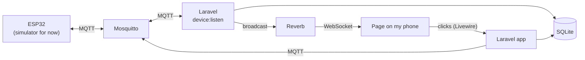

# water-tank-controller

[](https://github.com/Schaulagain/water-tank-controller/actions/workflows/tests.yml)

A small system to keep an eye on the water tanks at home and run the water pump from my phone.

The pump fills the roof tank from the underground tank. Right now it's switched on and off by hand, which means forgetting it and overflowing the roof tank, or forgetting to fill it at all.

The hardware isn't here yet, so for now a simulator stands in for it. The simulator talks to the server exactly the way the real board will, so swapping it out later shouldn't change anything else.

## What it does

- Shows the water level in both tanks on a web page that works well on an iPhone, with live updates
- Turns the pump on when the roof tank gets low and off when it's full
- Keeps the pump off while the underground tank is nearly empty, so it never runs dry
- Lets me switch the pump on or off by hand from the page
- Stops the pump if it runs far longer than a normal fill, and sends a notification to my phone
- Waits a couple of minutes after a power cut before starting the motor
- Keeps a day's chart of both tanks and a list of recent pump runs

## How it fits together



The device decides when the pump runs. The server stores what it reports, shows it, and passes on commands and settings. If the server or WiFi goes down, the tanks still fill properly.

| Folder | What's in it |
| --- | --- |
| [`server/`](server) | Laravel 13 app: Livewire pages, the MQTT listener, Reverb for live updates |
| [`simulator/`](simulator) | The pretend controller and the control logic, with tests |
| [`docs/`](docs) | [The control logic](docs/control-logic.md) and [the MQTT messages](docs/device-protocol.md) |
| `firmware/` | The ESP32 code, once the hardware arrives |

## Running it

You need Docker.

```sh
cp .env.example .env
docker compose up -d --build
docker compose exec app php artisan user:create you@example.com
```

Then open http://localhost:8000 and log in. The simulator starts with the tanks partly full. The Simulator page lets you change water use, cut the power, jam a sensor and so on, then watch the Tanks page react.

On an iPhone, open the page in Safari and use Share → Add to Home Screen to get it as an app.

Services and ports:

| Service | Port | Job |
| --- | --- | --- |
| app | 8000 | The web page |
| reverb | 6001 | Live updates for the page |
| mosquitto | 1883 | MQTT broker the device connects to |
| listener | | Reads device messages into the app |
| scheduler | | Checks for a quiet device every minute and prunes old readings |
| simulator | | The pretend controller |

### Notifications

Install the ntfy app on your phone, subscribe to a long random topic name, and put the same name in `NTFY_TOPIC` in `.env`. It uses the public ntfy.sh server for now, and `NTFY_URL` can point at a self-hosted one later.

You get a notification when the pump is stopped for safety, when the underground tank runs low, when the roof sensor stops reading, and when the controller has been offline for five minutes.

### Reaching it from outside

The plan is to run it on my [homelab](https://github.com/Schaulagain/my-homelab) and reach it over Tailscale, at `http://<homelab>:8000`. Set `APP_URL` to that address. Nothing is opened to the internet.

## Tests

```sh
cd simulator && composer install && vendor/bin/phpunit
cd server && composer install && php artisan test
```

The simulator tests cover the control logic: thresholds, the dry-run block and float switch, the longest-run fault, the wait after a power cut and manual mode. The server tests cover message handling, pump run tracking, notifications, the offline check and the pages.

## Hardware (planned)

| Part | Job |
| --- | --- |
| ESP32 board | Reads the sensors, runs the control logic, switches the contactor |
| JSN-SR04T ultrasonic sensor, one per tank | Measures how full each tank is |
| Float switch near the bottom of the underground tank | Backup against running dry if the ultrasonic sensor gets it wrong |
| Contactor | Switches the pump's 230V supply |
| 5V power supply | Powers the ESP32 |

The pump is a single-phase motor of about 0.5 to 1 HP. An electrician will wire the contactor to the mains. I'm doing the low-voltage side and the code.

## License

MIT
